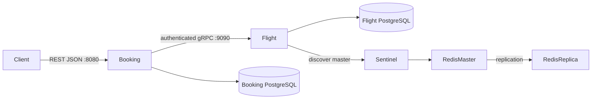

# Architecture and failure semantics

The three Maven modules separate wire contract from independently deployed applications. Booking has no Flight JDBC credentials and no flight repository. Business communication is exclusively gRPC. HTTP on Flight :8081 is an internal actuator health endpoint.

## Transactions and locks

ReserveSeats takes a PostgreSQL transaction-scoped advisory lock derived from booking UUID, then a pessimistic flight row lock (`SELECT FOR UPDATE`). All reservation operations follow booking lock -> flight lock ordering; updates lock only the flight. Hash collisions merely serialize unrelated bookings. The advisory lock prevents concurrent same-key inserts, including requests naming different flights; UNIQUE(booking_id) remains a database backstop. Stock decrement and reservation insert commit in one transaction. Matching replays return the existing reservation, even RELEASED/EXPIRED, without reactivating it. Mismatching parameters return ALREADY_EXISTS.

ReleaseReservation uses the same locks. Only ACTIVE -> RELEASED restores seats. Replaying a release returns the recorded result. EXPIRED is supported by the schema/contract; no expiry scheduler is part of this system.

Creation: GetFlight price snapshot -> generate UUID -> ReserveSeats with that UUID -> multiply BigDecimal price by seat count -> commit local CONFIRMED booking. A failed local commit triggers ReleaseReservation and records compensation success/failure. This is a small Saga, not distributed ACID. Failed compensation or process death between commits requires reconciliation using logged booking UUIDs and SQL; there is no durable saga coordinator. A timeout after a remote commit also has an ambiguous outcome: gRPC retries reuse the same key, but if all attempts fail, operational reconciliation may be necessary. REST creation itself does not accept an idempotency key.

Cancellation locks the local booking, requires CONFIRMED, calls release, then writes CANCELLED. Failed release rolls back local changes. A local commit failure after successful release can be recovered by retrying cancellation because release is idempotent. Concurrent cancellation serializes on the booking row.

## Cache and resilience

FlightCache explicitly reads Redis, logs HIT/MISS, falls back to PostgreSQL, then writes protobuf bytes encoded as Base64 with a positive TTL (default 600s). Redis outages degrade to PostgreSQL. Transactions register invalidation only after commit: flight ID plus route departure UTC date plus ALL. Updating dates evicts both old and new date keys. No global flush is used by application code. Failed invalidation is logged; TTL bounds persistence of stale entries. Concurrent read-through fills can race invalidation; this demo does not promise linearizable cache reads across service replicas.

Lettuce discovers the writable master using Sentinel (`mymaster`), rather than a fixed master address. One sentinel with quorum 1 demonstrates discovery/failover, but is not a production quorum. Replication is asynchronous; failover can lose recent cache writes. PostgreSQL remains authoritative.

RetryPolicy performs at most three attempts, 0/100/200ms configurable backoff and a fresh per-attempt deadline. Only UNAVAILABLE/DEADLINE_EXCEEDED are retried. Client middleware implements CLOSED/OPEN/HALF_OPEN. OPEN fails locally with CIRCUIT_OPEN; retry stops immediately. HALF_OPEN admits one probe, then closes on success or opens on failure. Infrastructure failures count per wire attempt, so the threshold may be reached inside one logical operation. Channel-native retries are disabled.

The API key is attached by a ClientInterceptor and verified by a ServerInterceptor on every Flight method. Local Compose uses an explicitly non-production demo value. Plaintext gRPC is for the private demonstration network; deployments should add TLS and manage credentials securely.

## Status mapping

| gRPC | REST | Meaning |
|---|---|---|
| INVALID_ARGUMENT | 400 | malformed UUID, route, date, seat count or update |
| NOT_FOUND | 404 | flight, reservation or booking absent |
| RESOURCE_EXHAUSTED | 409 | insufficient inventory |
| FAILED_PRECONDITION | 409 | flight/booking state disallows operation |
| ALREADY_EXISTS | 409 | conflicting idempotency key or flight number/date |
| UNAUTHENTICATED | 503 | interservice authentication failed; key never exposed |
| UNAVAILABLE / DEADLINE_EXCEEDED | 503 | infrastructure failure or open circuit |
| INTERNAL | 500 | unexpected failure; implementation details hidden |

REST errors contain `error_code`, `message`, `details`. Invalid payloads use generic safe messages rather than echoing private passenger data.
