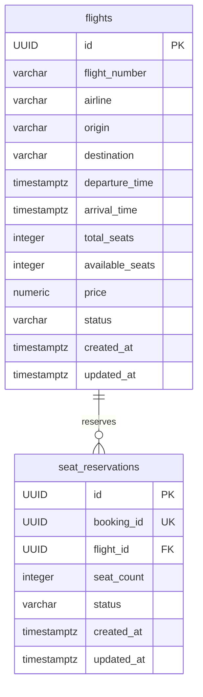
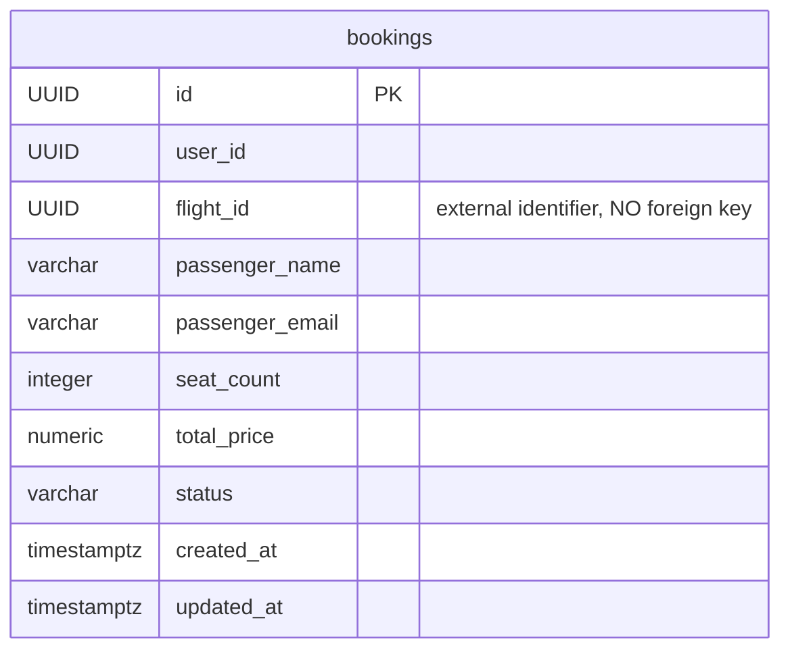

# Two independent PostgreSQL databases

## Flight database

## Booking database

No cross-database relationship or access exists. `booking_id` in Flight is a unique external correlation/idempotency identifier, not a cross-database FK. Flight identifiers in Booking are external references only.

All attributes are atomic. Flight/reservation facts depend on their own keys. Airline is a descriptive flight attribute; no airline contact/address facts are duplicated. Passenger name/email are the booking's passenger snapshot, not a user directory dependency. `total_price` is the immutable agreed purchase amount, not derived from a mutable remote price. Amounts use NUMERIC(14,2) and BigDecimal; contract money uses integer minor RUB units. Available stock is an intentional materialized inventory counter maintained transactionally, rather than recalculated across reservation history. Schemas otherwise follow 3NF with no transitive non-key dependencies.

Checks enforce IATA syntax, distinct endpoints, positive capacity and prices, stock bounds, ordered timestamps and enum domains. Flight number + departure UTC date is uniquely indexed using immutable `(departure_time AT TIME ZONE 'UTC')::date`; correctness does not depend on the session timezone. TIMESTAMPTZ represents instants; service conversion, JDBC and seed timestamps consistently use UTC. All local FK constraints stay inside Flight PostgreSQL.
